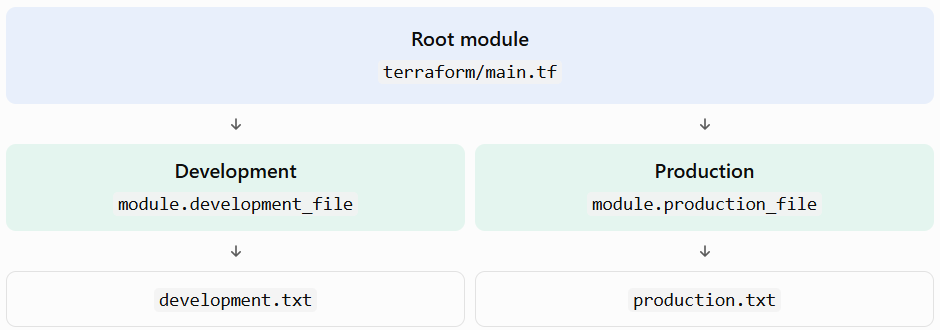

# Terraform day to day diary

## Day 1 
the beginning of my studies for better specialization in cloud engineering

I spent about 3 hours reading documentation and making notes, then made a simple .tf that creates a docker container with nginx running inside. 

I explored a bit with the variables and outputs file.

I then added a volume because i wanted to print a simple message and understand how i could mount an html page into the container in HCL!

Bottom line this was half a day well spent!!


## Day 2
I now created a local_file resource and experimented with .tfvars files.

Questions I can now easily answer:

1. What's the difference between a variable and a resource?

A resource is any infrastructure object you want to create and manage with Terraform.
A variable are dynamic and alterable values of resource configuration values. You can have variable blocks and then reference the block, inject them in the command line, have enviroment variables, etc. This way resources and modules are reusable and not hardcoded.

2. What is the difference between var.name and local.name?

As you can deduct from the name. a var.name is a VARIABLE name. It is not hardcoded and its injected into the configuration from a variable block, command line, .tfvars file...
A local.name is hardcoded and its defined internally in my terraform code. Its usually for repetitive or complex values that i dont want to change ever and for keeping my code clean.

3. What happens if a variable has no default?

Since a default value is mandatory it either prompts you to enter a value or gives and error message (in Automated, CI/CD Pipeline).

4. Why is variable validation useful?

When you give the user power to change code through variables you need to establish a set of rules applied through validations because the code also only works within a set of rules. You dont want it to break or for the user/developer to not understand what is filing. validations give you a sense of where the issues are when something regarding variables goes wrong because of the error messages.


I Then went into Outputs, Locals and Data sources.

I defined The outputs i wanted.
Locals helped me define an expression that i needed it to be reusable.
Here is where Terraform got really useful for me: Data sources

I tested this with a simple input.txt file that existed already in my repo so that Terraform would read it and give me the content in an output. 
What made it useful for me is that if you're going into a company that is deploying an app with, for example,  Azure, I wouldnt want to create a new virtual network. The company already has one. And now I know how to retrieve it and deploy my application into it.

While resources create/update/destroy infrastructure, data retrieves. Its read-only.

This example helped me out a lot to see this implemented in a real life scenario:

Imagine youre deploying an Azure Virtual Machine or a Kubernetes cluster, and it needs to live inside a Virtual Network.
If your team is responsible for creating the VNet from scratch within this specific Terraform project, you define a resource.

```hcl
resource "azurerm_virtual_network" "main" {
  name                = "production-vnet"
  address_space       = ["10.0.0.0/16"]
  location            = "eastus"
  resource_group_name = "rg-networking"
}
```

If they already created the Virtual Network in a separate Terraform project or directly in the Azure Portal, you just need to reference its ID so your subnets or virtual machines can attach to it

```hcl
data "azurerm_virtual_network" "existing" {
  name                = "production-vnet"
  resource_group_name = "rg-networking"
}

resource "azurerm_subnet" "internal" {
  name                 = "internal-subnet"
  resource_group_name  = "rg-networking"
  virtual_network_name = data.azurerm_virtual_network.existing.name
  address_prefixes     = ["10.0.1.0/24"]
}
```
Then I applied what I learned to a more realistic work setting.
Assuming my company has 3 environments:
- Dev
- Staging
- Prod

And each one needs:
- A Vnet
- A subnet
- Security rules
- some Infrastructure resources

Instead of writing the same Terraform code 3 times I created a module.

The terraform_2/modules/text_files is my first reusable module

Terraform module architecture




What is a Terraform variable?


What is the difference between a variable and a local?


What is an output?


What is a data source?


What is a Terraform module?


What is the root module?


Why are reusable modules important in large organisations?